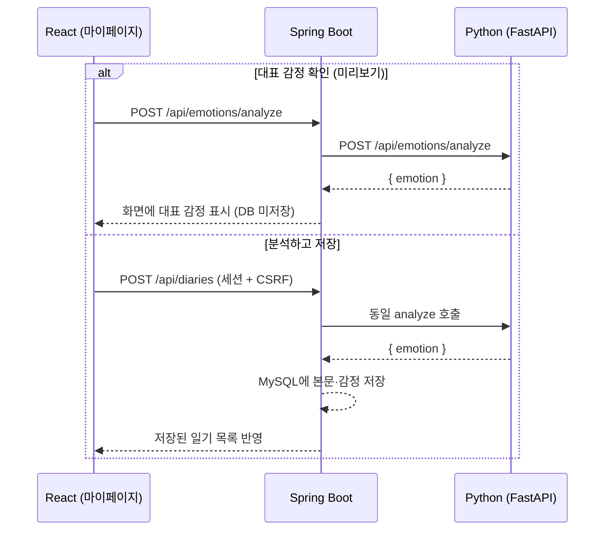

# Emotion Community

**개인 일기**에는 감정 추론 결과까지 포함해 본인만 볼 수 있는 기록을 남기고, **커뮤니티**에는 기꺼이 공유할 글만 올립니다. 한쪽은 분석·보관에, 다른 쪽은 읽기·대화에 맞춰 API·화면·권한을 나눴습니다. 같은 본문을 쓰더라도 일기가 커뮤니티에 노출되지 않도록, **두 공간을 처음부터 분리**해 설계했습니다. 한국어 일기를 쓰면 대표 감정 하나를 확인할 수 있고, 로그인 후에는 일기로 저장할 수 있습니다.

> *This is… is.*

---

## 무엇을 만들었는가

| 공간 | 설명 |
|------|------|
| **마이페이지** | 본인 일기만 조회. 감정 라벨과 함께 작성·수정·삭제 (로그인 + CSRF) |
| **커뮤니티** | 공개 글 목록·댓글 **읽기**는 비로그인 가능. 글·댓글 **쓰기·지우기**는 로그인 + CSRF |

### 커뮤니티 권한 (`SecurityConfig` 기준)

게시글과 댓글은 **HTTP 메서드·경로별**로 다르게 열립니다. 변경 요청(POST·PUT·DELETE)은 컨트롤러에서 **CSRF 헤더**를 검사합니다.

| 대상 | 조회 (GET) | 작성 (POST) | 수정 (PUT) | 삭제 (DELETE) |
|------|------------|-------------|------------|---------------|
| **공개 글** `/api/community/posts` | 누구나 | 로그인 사용자 | 로그인 + **글 작성자만** (서비스) | 로그인 + **글 작성자만** (서비스) |
| **댓글** `…/posts/{id}/comments`, `/api/community/comments/{id}` | 누구나 | 로그인 사용자 | *(없음)* | 로그인 + **댓글 작성자만** (서비스) |

- 글 **작성자**가 다른 사람 댓글을 대신 삭제할 수는 없습니다.
- 게시글을 삭제하면 DB `ON DELETE CASCADE`로 해당 글의 댓글이 함께 제거됩니다.

감정 추론은 한국어 KLUE-BERT 기반 분류 모델(`dlckdfuf141/korean-emotion-kluebert-v2`)을 사용하며, 라벨은 **공포 · 놀람 · 분노 · 슬픔 · 중립 · 행복 · 혐오** 일곱 가지 중 **대표 감정 하나**로 표시됩니다.

---

## 일기 한 편의 감정 분석 흐름

개발 환경에서는 React(Vite)가 `/api` 요청을 Spring Boot(8080)로 프록시합니다. Spring Boot는 필요할 때 Python 추론 서버(기본 8000)를 호출합니다.



관련 코드 위치:

- **미리보기:** `myapp/src/DiaryPage.tsx` — `handleSubmit` → `POST /api/emotions/analyze`
- **Spring 중계:** `EmotionController`, `EmotionInferenceService` → `emotion.inference.base-url`(환경 변수 `EMOTION_INFERENCE_URL`, 기본 `http://127.0.0.1:8000`)
- **추론 구현:** `ai/api_server.py`, `ai/emotion_engine.py`
- **저장 시 재분석:** `DiaryService.create` / `update` — 저장·수정마다 `emotionInferenceService.analyze` 호출 후 `Diary`에 본문과 감정 저장

---

## 긴 일기를 나누고 대표 감정 하나를 고르는 방법

모델 입력 길이는 **최대 512 토큰**(특수 토큰 2개를 제외한 본문 **510 토큰**)입니다 (`emotion_engine.py`의 `MAX_SEQ_LEN`, `SPECIAL_TOKEN_SLOTS`).

1. **짧은 글** (토큰 수 ≤ 510)  
   전체 텍스트로 한 번 추론하고, softmax 확률이 가장 큰 클래스를 대표 감정으로 선택합니다.

2. **긴 글** (토큰 수 > 510)  
   - `tokenizer.encode`로 얻은 토큰 ID를 510개 단위로 잘라 **여러 세그먼트**로 나눕니다 (`_segment_token_ids`).
   - 각 세그먼트를 다시 디코딩해 개별로 추론하고, 세그먼트별 softmax 벡터를 **토큰 수 비율(가중치)** 로 합산합니다.
   - 합산된 평균 확률에서 argmax인 라벨을 **일기 전체의 대표 감정**으로 반환합니다.

즉, 긴 일기는 “앞부분만 본다”가 아니라 **구간별 감정을 가중 평균**해 하나를 고릅니다.

---

## 「대표 감정 확인」과 「분석하고 저장」의 차이

| | **대표 감정 확인** | **분석하고 저장** |
|---|------------------|-------------------|
| **UI** | 폼 `submit` (로그인 시 보조 버튼) | `분석하고 저장` 버튼 (`handleSave`) |
| **인증** | 불필요 (`/api/emotions/**` 허용) | 로그인 필수 + CSRF |
| **API** | `POST /api/emotions/analyze` | `POST /api/diaries` |
| **DB** | **저장하지 않음** — 화면에만 `대표 감정: …` 표시 | **MySQL `diaries`에 본문·감정·작성 시각 저장** |
| **분석 시점** | 버튼을 누를 때마다 즉시 | 저장(또는 일기 수정) 요청 처리 시 Spring이 다시 analyze 호출 |

로그인한 사용자에게는 화면 안내 그대로, *대표 감정 확인*은 미리보기이고 *분석하고 저장*은 내 일기 목록에 남는 동작입니다. 일기 **수정** 시에도 서버가 본문을 다시 분석해 감정 필드를 갱신합니다 (`DiaryService.update`).

게스트는 감정 미리보기만 가능하고, 저장·목록 조회는 로그인 후에만 됩니다.

---

## 기술 스택

| 영역 | 구성 |
|------|------|
| **Frontend** | React, TypeScript, Vite, React Router |
| **Backend** | Java 25, Spring Boot 4, Spring Data JPA, Spring Security (세션, 쿠키 CSRF), MySQL, Flyway |
| **AI** | Python 3.12, FastAPI, PyTorch, Hugging Face Transformers |

---

## 로컬 실행 (Windows PowerShell)

저장소를 클론한 뒤, 아래를 **저장소 루트**(`emotion-community` 폴더) 기준으로 진행합니다.

### 사전 준비: MySQL

1. MySQL이 `localhost:3306`에서 동작하는지 확인합니다.
2. 데이터베이스 `emotion_community`를 만들고, 앱에서 쓸 계정에 해당 DB 권한을 부여합니다.
3. Flyway는 Spring Boot **첫 기동 시** `backend/src/main/resources/db/migration`을 적용합니다.

이후 **프로세스용 터미널 세 개**를 엽니다. 각 터미널의 **시작 위치는 모두 저장소 루트**입니다.

### 터미널 1 — Python 감정 추론 (8000)

**시작 위치:** 저장소 루트

검증 환경: **Python 3.12.10** (`ai/.venv`). Windows에서 `python`이 없으면 `py -3.12`를 사용합니다.

```powershell
Set-Location .\ai
py -3.12 -m venv .venv
.\.venv\Scripts\Activate.ps1
pip install -r requirements.txt
python api_server.py
```

첫 기동 시 Hugging Face에서 모델 가중치를 받으므로 시간이 걸릴 수 있습니다. 서버는 기본적으로 `127.0.0.1:8000`에서 대기합니다.

### 터미널 2 — Spring Boot API (8080)

**시작 위치:** 저장소 루트

`backend/src/main/resources/application.properties`는 `spring.datasource.*`를 **환경 변수**로 덮어쓸 수 있습니다. **이 터미널에서만** 아래를 설정한 뒤 기동합니다.

| 환경 변수 | `application.properties` 키 | 용도 |
|-----------|------------------------------|------|
| `DB_URL` | `spring.datasource.url` | JDBC URL (예: `jdbc:mysql://localhost:3306/emotion_community`) |
| `DB_USERNAME` | `spring.datasource.username` | MySQL 사용자 |
| `DB_PASSWORD` | `spring.datasource.password` | MySQL 비밀번호 |

선택: 추론 서버 주소 변경 시 `EMOTION_INFERENCE_URL` (`emotion.inference.base-url`, 기본 `http://127.0.0.1:8000`).

```powershell
$env:DB_URL = "jdbc:mysql://localhost:3306/emotion_community"
$env:DB_USERNAME = "<your-mysql-user>"
$env:DB_PASSWORD = "<your-mysql-password>"
Set-Location .\backend
.\mvnw.cmd spring-boot:run
```

래퍼 파일명은 Windows용 **`mvnw.cmd`** 입니다 (Unix는 `mvnw`). 기동 후 API는 `http://localhost:8080` 입니다.

### 터미널 3 — Vite 개발 서버

**시작 위치:** 저장소 루트

```powershell
Set-Location .\myapp
npm install
npm run dev
```

터미널에 표시되는 **`Local:`** 주소(예: `http://localhost:5173/`)를 브라우저에서 엽니다. 프런트의 `/api` 호출은 `myapp/vite.config.js`에서 `http://localhost:8080`으로 프록시됩니다.

---

## 저장소 구조 (요약)

```
emotion-community/
├── ai/                 # FastAPI 감정 추론
├── backend/            # Spring Boot REST API
├── myapp/              # React 프런트엔드
└── README.md
```

```java
public static void main(String[] args) {
    // 진입점은 여기서 끝나지 않고, 위 실행 순서에서 이어집니다.
}
```